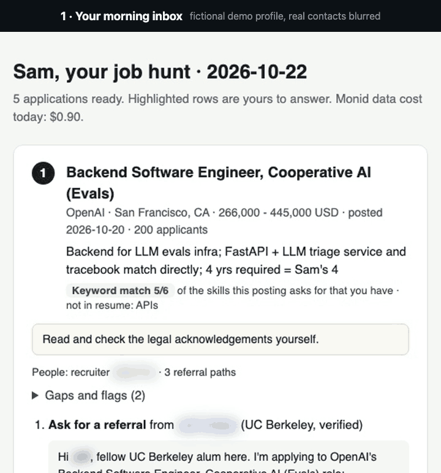
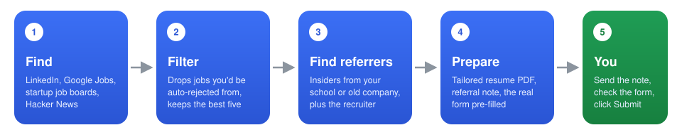
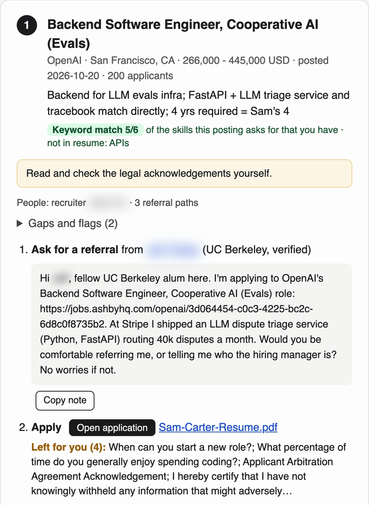
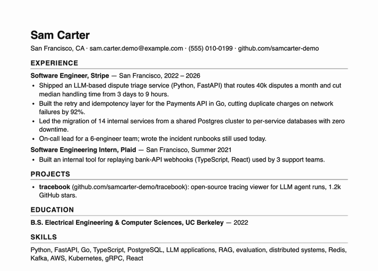
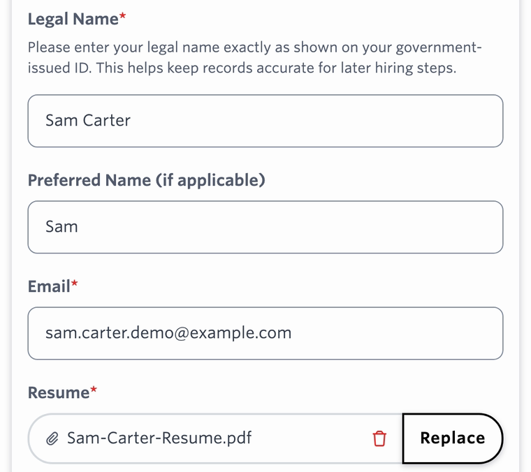

<div align="center">

# warm-apply

**An AI job hunter that gets you referred before it helps you apply.**

[](LICENSE)


[](https://monid.ai?fpr=charles)



<sub>A real run on a fictional demo profile (Sam Carter). Real people's names are blurred. Nothing was submitted or sent.</sub>

</div>

Recruiters now get more than 300 applications for every hire ([Ashby, May 2026](https://www.prnewswire.com/news-releases/new-data-from-ashby-reveals-surge-in-applications-rising-selectivity-and-shifting-recruiter-workloads-302765846.html)). Cold applications reach an interview about **3%** of the time; referred candidates about **40%** ([Ashby, 38M applications](https://www.ashbyhq.com/talent-trends-report/reports/referrals)). Having AI apply to 500 jobs for you just adds to the pile.

warm-apply does the opposite. Give it your resume once. Every morning you get a short list of jobs that fit, each with a referral note ready to send and the company's real application filled in up to the Submit button.

## Quick start

Paste this into Claude Code, Codex, Cursor or Gemini CLI, with your resume handy:

```text
Set up https://github.com/goodnight000/warm-apply for me and run my job hunt.
```

It installs itself, asks one round of questions, and ends with your first inbox. Then it offers to run every weekday morning. You need a [Monid](https://monid.ai?fpr=charles) API key; new accounts get $1 of free credit, enough for the first day.

## How it works

<p align="center"></p>

<details>
<summary><b>Each step in detail</b></summary>

1. **Find** new jobs on LinkedIn, Google Jobs, startups' own Greenhouse, Lever and Ashby pages, Hacker News "Who is hiring?", and the job boards (including Workday) of companies you pick. Hiring posts on X and Glassdoor are opt-in.
2. **Filter** out jobs you'd be auto-rejected from: no visa sponsorship when you need it, clearance or citizenship requirements, years far beyond yours, pay below your floor, the wrong place, staffing agencies and scam signals. It scores the rest, and your agent reads the best ones against your resume and picks up to five.
3. **Find referrers**: current employees who went to your school or worked at your old company, found through ContactOut's people search, in your own job function first. Also the likely hiring manager and the recruiter. It keeps an email only when it's on the company's own domain.
4. **Prepare** a resume tailored to the posting (rendered to PDF), the referral note, a cover note if the form asks for one, and an email to the hiring manager or recruiter. It reads the company's real Greenhouse, Lever or Ashby form and answers every field it can from your saved answers. Every claim must trace back to your resume; a check blocks numbers it can't find there.
5. **You** open one inbox page, copy the referral note, click **Open application**, check the highlighted fields and click Submit. Legal acknowledgements, AI-use policies and personal preferences are always left for you.

</details>

## What lands in your inbox

<table>
<tr>
<td width="50%" valign="top"></td>
<td width="50%" valign="top"><br><br></td>
</tr>
<tr>
<td align="center"><sub>One card per job: why it fits, who can refer you, the note to send, and what's left for you</sub></td>
<td align="center"><sub>A one-page resume tailored to the posting, already attached to the company's real form</sub></td>
</tr>
</table>

<sub>Fictional demo profile. The referral contact and recruiter are real people, so their names are blurred.</sub>

## What it won't do

- **Submit, send or email anything.** You click Submit and send every message yourself.
- **Touch LinkedIn Easy Apply or Indeed Apply**, whose terms forbid automation.
- **Spray applications.** Five prepared jobs a day by default, ten at most. The point is fewer, better applications.

## Cost

<a href="https://monid.ai?fpr=charles"><picture><source media="(prefers-color-scheme: dark)" srcset="docs/images/monid-logo-white.svg"></picture></a>

All paid data goes through [Monid](https://monid.ai?fpr=charles): one API key for 1,700+ APIs, paid per call, no subscription. That covers LinkedIn job search, Google Jobs, Apollo, Hunter, funding and news data, and ContactOut, whose API normally takes a sales meeting to get. Through Monid it's the same key as everything else, about $0.02 per profile.

| | Cost |
|---|---|
| Daily search | about $0.35 |
| Each prepared job (research, contacts, referrers) | about $0.10–0.20 |
| A typical day, five prepared jobs | about $1 (measured first run: $0.90) |
| Application forms, PDFs, free job boards | free |
| Default caps | $1.00 per run, $1.50 per day |

Every call is logged with what it cost. **[Sign up for Monid →](https://monid.ai?fpr=charles)**

## Set up

**Ask your agent** (easiest): paste the [quick start](#quick-start) line. The agent installs everything, asks about roles, cities or remote, salary floor, work authorization, schools and past employers, and finishes with your first inbox.

**By hand:**

```sh
git clone https://github.com/goodnight000/warm-apply ~/warm-apply
~/warm-apply/install.sh
```

Then open your agent anywhere and say **"Set up my job hunt"** with your resume attached. Runs on macOS and Linux; on Windows, use WSL.

<details>
<summary>What <code>install.sh</code> does</summary>

It checks for Python 3.9+, installs the Monid CLI, registers your key (`MONID_API_KEY=… ~/warm-apply/install.sh`, or it tells you how), checks for Chrome (used to render PDFs), links the skill into Claude Code (`~/.claude/skills`) and Codex, Cursor and Gemini CLI (`~/.agents/skills`), and runs the offline self-test.

</details>

| You want | Say |
|---|---|
| A fresh inbox now | "run my job hunt" |
| A fresh inbox every weekday | "run my job hunt every weekday at 9" |
| To stop the schedule | "stop my job hunt schedule" |

<details>
<summary>How the daily schedule works</summary>

The agent runs `jobhunt.py schedule --at 09:07`, which installs a launchd job on macOS or a cron job on Linux that starts your agent headless and does the full run. On a Mac it sends a notification when it's done, and if the Mac was asleep at that time, it runs when it wakes. Under Claude Code the unattended agent may run only this skill's script and write only inside your job-hunt folder, because job postings are untrusted text and nobody is watching. Codex runs need its full-access mode, since its sandbox blocks the network. `schedule --remove` stops it.

Claude Code Desktop and Codex app scheduled tasks and GitHub Actions also work; see [scheduling.md](skills/job-hunt/references/scheduling.md).

</details>

**Claude.ai or ChatGPT (no terminal):** add the Monid connector (`https://mcp.monid.ai/v1`) and upload the `skills/job-hunt` folder as a skill. The agent follows [chat-mode.md](skills/job-hunt/references/chat-mode.md): a lighter version of the same run, with no form filling or PDFs.

## For AI agents installing this

You've been asked to set this up for your user, either as a one-time run or a daily automation. Do these in order:

1. **Get the code.** `git clone https://github.com/goodnight000/warm-apply ~/warm-apply`, or `git -C ~/warm-apply pull` if it's already there.
2. **Install.** Run `~/warm-apply/install.sh` and read what it prints.
   - If the Monid key is missing, send the user to https://monid.ai?fpr=charles to sign up ($1 free credit), then to https://app.monid.ai/access/api-keys to create a key. Have them run `monid keys add -k THEIR_KEY -l main` themselves. If they paste the key to you instead, run that command for them and never repeat the key back.
   - Rerun `install.sh` until it prints "Ready".
3. **Load the skill.** It's now linked into `~/.claude/skills/job-hunt` and `~/.agents/skills/job-hunt`, so future sessions find it. If your session loaded skills before the install, read `~/warm-apply/skills/job-hunt/SKILL.md` now and follow it directly.
4. **Set it up** by following SKILL.md's "Set up (first session)". The user's files go in `~/job-search/job-hunt/`. Ask your questions in one message, and end the session with the first inbox open.
5. **Offer the automation** (SKILL.md, step 7). Ask the time, run `jobhunt.py schedule --at HH:MM` (add `--agent codex` if you are Codex), and offer one test run. If the user only wants a one-time run, skip this; they can say "run my job hunt" any day.

Hard rules: never click Submit, send a message or email anyone for the user. Never put the user's `job-hunt/` folder in a public repository, because it holds their resume and answers. Stop at the budget the user sets.

If you can't run shell commands, use [chat-mode.md](skills/job-hunt/references/chat-mode.md) instead.

## What's in here

| Path | What it is |
|---|---|
| [`skills/job-hunt/SKILL.md`](skills/job-hunt/SKILL.md) | The agent's procedure: setup, the daily run, applying, the weekly review |
| [`skills/job-hunt/references/`](skills/job-hunt/references) | Drafting, applying, sources and costs, scheduling, chat mode |
| `skills/job-hunt/scripts/jobhunt.py` | The pipeline: search, dedupe, filter, score, research, forms, lint, PDFs, inbox, stats, schedule. Standard-library Python, no dependencies |
| `skills/job-hunt/scripts/forms.py` | Reads and pre-fills Greenhouse, Lever and Ashby forms |
| [`DESIGN.md`](DESIGN.md) | Why it works the way it does, with measured costs |
| [`research/`](research) | The evidence behind it, gathered October 2026 |

**Privacy:** your files stay on your machine, in `~/job-search/job-hunt/`. Paid lookups go through Monid, free job boards and forms are fetched directly, and your agent's model provider sees what the agent reads.

**Tests:** `cd skills/job-hunt/scripts && python3 -m unittest test_jobhunt.py`. They run offline, replaying recorded responses.

## License

MIT
